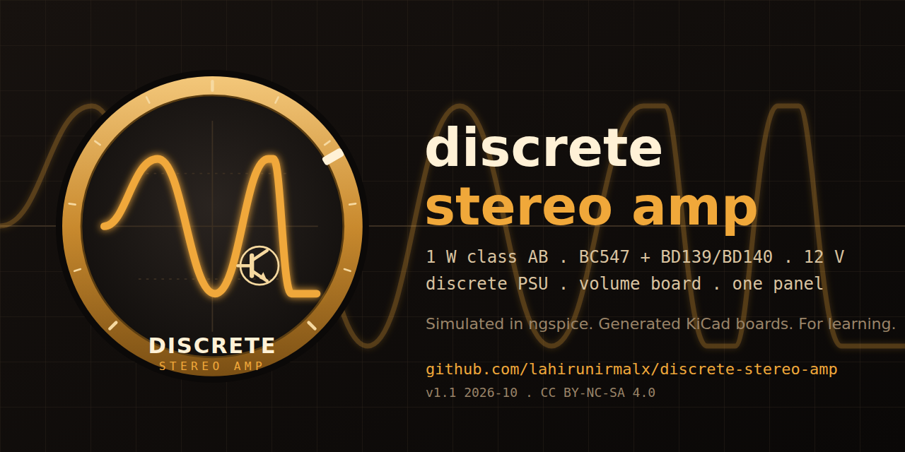
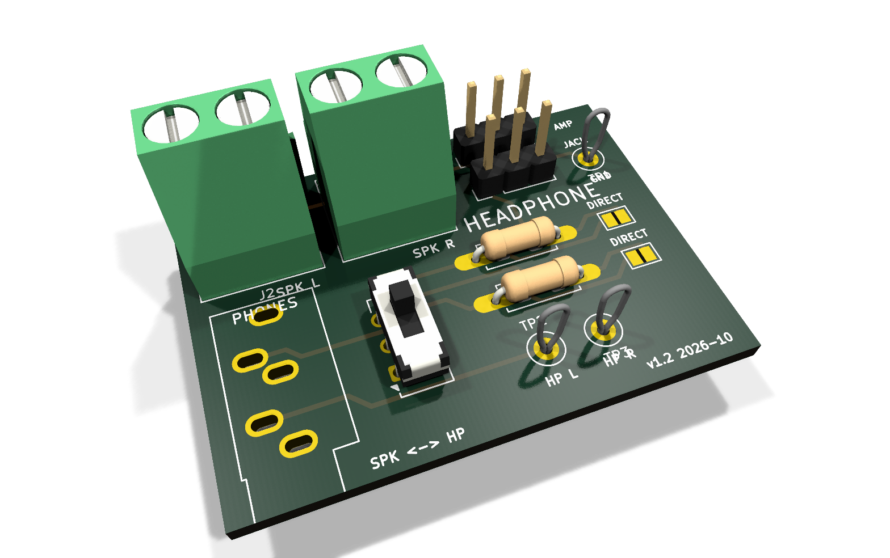
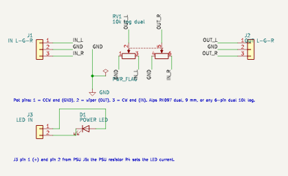
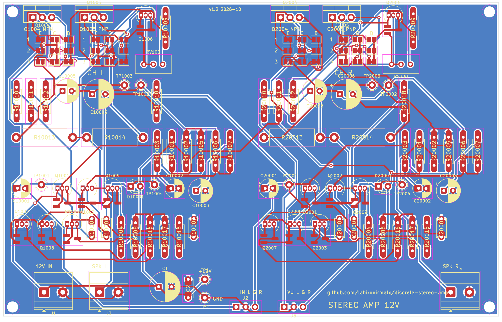
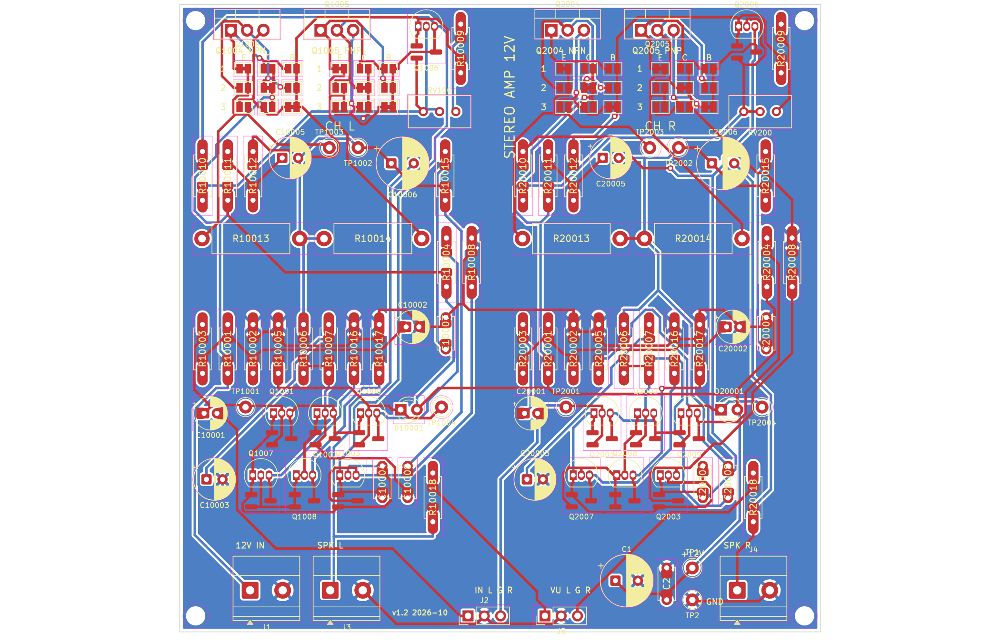
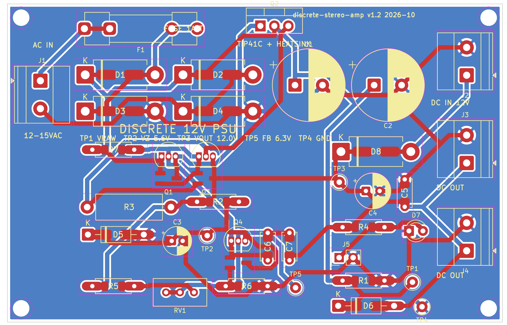
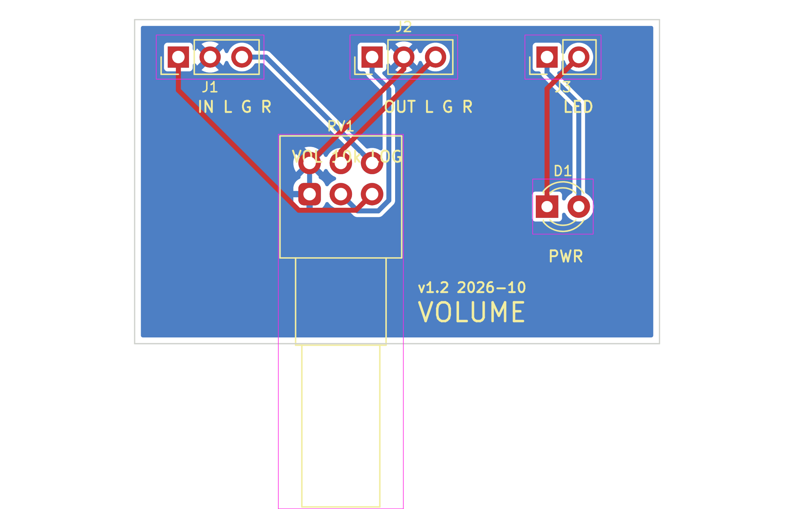
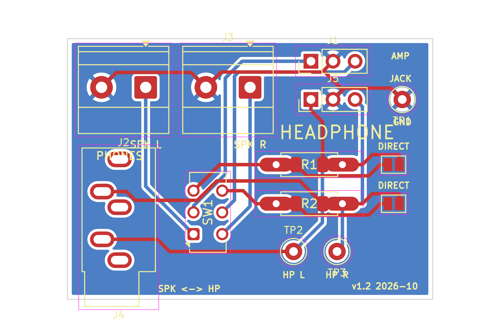
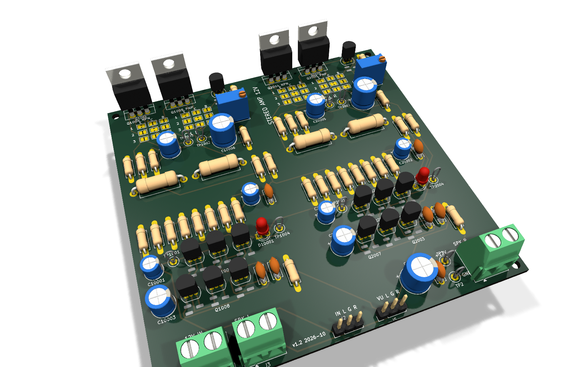
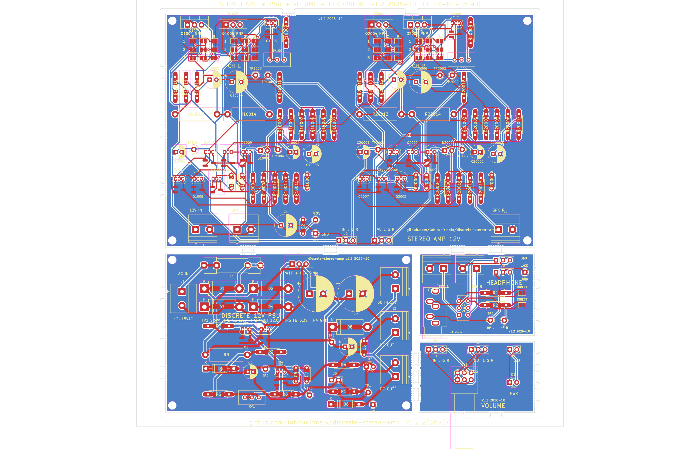

# Stereo class-AB amplifier, discrete 12 V supply, volume and headphone boards

A hobby / learning project: a two-channel 1 W class-AB amplifier built from BC547/BC557/BD139/BD140,
its own transformer-fed discrete supply, a volume board and a headphone board, all on one fab panel. It grew
out of a review of a one-transistor "speaker in the collector" amp, which could not be fixed by changing
values. Every number here comes from ngspice; **no board has been built or measured yet** (release 1.2 is a
prototype design). Release 2 rebuilt the amp front end for ten times less distortion, closed the supply's
regulation loop, added a VU meter tap and the headphone board.

| Amp | PSU | Volume | Headphone |
|---|---|---|---|
|  |  |  |  |

More views in [docs/images/](docs/images/): top-down 3D renders and the single-sided layouts. Logo and banner: `logo.svg` / `logo.png` / `logo-1024.png` and `banner.svg` / `banner.png` (1280 x 640, the GitHub social-preview size).

## Schematics

| Amp (both channels) | PSU | Volume | Headphone |
|---|---|---|---|
|  |  |  |  |

PDFs of all four are in the release zip (`schematics/`).

## Boards (2-layer layouts, top view, both copper layers)

| Amp, wide 134 x 85 mm | Amp, compact 100 x 98 mm | PSU 90 x 58 mm | Volume 42 x 26 mm | Headphone 42 x 30 mm |
|---|---|---|---|---|
|  |  |  |  |  |

## What it does

| | |
|---|---|
| Output | 1.2 W into 8 ohm and 1.5 W into 4 ohm at the onset of clipping (per channel, 12 V); 0.29 W into 8 ohm at 0.02 to 0.05% THD, 52 mW into 4 ohm at 0.013% |
| Gain / input | 23 (27 dB), 46k input impedance, for a 10k log pot |
| Idle current | output stage 21 mA per channel after setting the trimmer (7 to 10 mV across a 0.47 ohm emitter resistor); about 34 mA per channel from the supply |
| Bandwidth | 20 Hz (8 ohm) / 34 Hz (4 ohm) to 120 kHz; 5.7% square-wave overshoot with 100 nF across the speaker |
| Supply | 12 to 15 VAC transformer (1.5 A for full power) or 12 V DC in; closed-loop 12.0 V out (trimmer 11.4 to 12.7 V), 0.14 V dip on a 1 A step, 2 A clamp |
| Headphones | DPDT switch speakers / phones, 120 ohm series (8 mW into 32 ohm), DIRECT jumpers, 3.5 mm jack or panel jack header |
| VU meter | 1x3 header on the amp, 1k in series with each speaker node (2.8 Vrms at 1 W) |
| Boards | amp 134 x 85 mm (or the compact 100 x 98 mm variant for the 100 x 100 fab tier), PSU 90 x 58 mm, volume 42 x 26 mm, headphone 42 x 30 mm; 2-layer panel 155 x 155 mm; single-sided variants |
| Parts | 145 through-hole parts with 1206 / SOD / SMA / SOT-23 twins on the same pads; 38 solder jumpers (output pinouts, headphone DIRECT) |

## Design rules this project keeps

1. **Modular.** Every board works alone; none depends on another. Build the amp only, add the volume board or the PSU later.
2. **Your parts, your build.** Every passive has through-hole pads plus a 1206 / SOD / SMA twin; every output transistor sits behind a 3x3 solder-jumper pinout block; the BOM lists at least three substitutes per transistor. Fit what you have.
3. **Debuggable by a beginner.** Every board carries labelled test points with the expected voltage printed next to them, and the bring-up guide walks through them in order.

Any change to this project is checked against these three before it is merged.

## Build it board by board

Every board works on its own; nothing is required by another board.

| You build | You need | What you get |
|---|---|---|
| Amp only | any 12 V DC supply of 1 A (wall adapter, bench supply) into "12V IN"; a phone, PC or DAC into the "IN L G R" header; speakers on the terminals | a working stereo amp; the source's own volume control sets the level (a phone at full volume will clip, so turn it down) |
| Amp + volume board | as above, plus the two 3-pin cables | a volume knob (and the front-panel LED position) |
| Amp + PSU | a 12 to 15 VAC transformer into the PSU, or 12 V DC into its "DC IN"; PSU "DC OUT" to the amp | a regulated, clamped, fused supply with the power LED |
| Amp + headphone board | three wires from the amp's speaker terminals to "FROM AMP", speakers on the headphone board's terminals | a speakers / phones switch and a jack |
| VU meters | any meter on the amp's "VU L G R" header | level display; nothing else changes |
| All four | the panel | the complete desk amp |

Two amp layouts carry the same circuit: the wide one (134 x 85 mm, matches the PSU plus headphone-and-volume
column on the panel) and the compact one (100 x 98 mm, fits JLCPCB's 100 x 100 mm tier when ordered alone).
Choose by price; there is no electrical difference.

## Documents

1. [docs/01-theory-of-operation.md](docs/01-theory-of-operation.md): every block explained for a first build, with the voltages to expect.
2. [docs/02-simulation-results.md](docs/02-simulation-results.md): all the ngspice tables, including the rejected candidates and the release 2 front end and supply (2.7 to 2.9).
3. [docs/03-design-review.md](docs/03-design-review.md): what was checked, what was found, what is not verified.
4. [docs/04-build-and-bringup.md](docs/04-build-and-bringup.md): assembly order, first power-up, bias setting, test points, troubleshooting.
5. [ORDER_GUIDE.md](ORDER_GUIDE.md): ordering the panel, substitutes, matching, tolerances.
6. [docs/05-preamp-study.md](docs/05-preamp-study.md): does a preamp stage help a line-level desk amp? (No; where it would.)
7. [docs/KNOWN_ISSUES.md](docs/KNOWN_ISSUES.md) and [docs/CHANGELOG.md](docs/CHANGELOG.md).
8. Interactive: [amp channel in CircuitJS](https://www.falstad.com/circuit/circuitjs.html?cct=$%201%200.000005%2010.20027730826997%2050%205%2050%0Av%2064%20480%2064%2064%200%200%2040%2012%200%200%200.5%0Ag%2064%20480%2064%20512%200%0Aw%2064%2064%20208%2064%200%0Aw%20208%2064%20288%2064%200%0Aw%20288%2064%20352%2064%200%0Aw%20352%2064%20528%2064%200%0Aw%20528%2064%20816%2064%200%0Av%20128%20480%20128%20368%200%201%201000%200.1%200%200%200.5%0Ag%20128%20480%20128%20512%200%0Ar%20128%20368%20192%20368%200%202500%0Ac%20192%20368%20256%20368%200%202.2e-06%200%200%0Ar%20208%2064%20208%20176%200%2047000%0Ar%20208%20176%20208%20480%200%2047000%0Ag%20208%20480%20208%20512%200%0Ac%20240%20176%20240%20480%200%204.7e-05%200%200%0Ag%20240%20480%20240%20512%200%0Aw%20208%20176%20240%20176%200%0Aw%20240%20176%20272%20176%200%0Ar%20272%20176%20272%20368%200%2047000%0Aw%20256%20368%20272%20368%200%0Aw%20272%20368%20304%20368%200%0At%20304%20368%20352%20368%200%201%200%200%20290%0At%20496%20368%20448%20368%200%201%200%200%20290%0Aw%20352%20384%20352%20416%200%0Aw%20352%20416%20400%20416%200%0Aw%20400%20416%20448%20416%200%0Aw%20448%20384%20448%20416%200%0Ar%20400%20416%20400%20480%200%2010000%0Ag%20400%20480%20400%20512%200%0Aw%20448%20352%20448%20320%200%0Aw%20448%20320%20528%20320%200%0Aw%20528%20320%20528%2064%200%0Ar%20288%2064%20288%20160%200%204700%0Aw%20288%20160%20288%20192%200%0Aw%20288%20192%20288%20240%200%0Aw%20288%20240%20352%20240%200%0Aw%20352%20240%20352%20352%200%0Aw%20496%20368%20528%20368%200%0Aw%20528%20368%20544%20368%200%0Ar%20544%20368%20608%20368%200%2022000%0A207%20608%20368%20640%20368%204%20out%0Ar%20528%20368%20528%20416%200%201000%0Ac%20528%20416%20528%20480%200%200.00022%200%200%0Ag%20528%20480%20528%20512%200%0At%20320%20192%20368%20192%200%20-1%200%200%20250%0Aw%20288%20192%20320%20192%200%0Ar%20352%2064%20352%20128%200%2047%0Aw%20352%20128%20368%20128%200%0Aw%20368%20128%20368%20176%200%0Aw%20368%20208%20368%20256%200%0Aw%20368%20256%20400%20256%200%0Aw%20400%20256%20608%20256%200%0Aw%20608%20256%20624%20256%200%0Aw%20624%20256%20736%20256%200%0Ac%20400%20192%20400%20256%200%201e-10%200%200%0A207%20400%20192%20432%20192%204%20c1%0A207%20288%20160%20256%20160%204%20c1%0Ar%20624%20256%20624%20304%200%20820%0At%20560%20304%20608%20304%200%201%200%200%20290%0Aw%20608%20288%20608%20256%200%0Aw%20560%20304%20560%20336%200%0Aw%20560%20336%20624%20336%200%0Aw%20624%20304%20624%20336%200%0Ar%20624%20336%20624%20400%200%201000%0Aw%20608%20320%20608%20400%200%0Aw%20608%20400%20624%20400%200%0Aw%20624%20400%20688%20400%200%0Aw%20688%20400%20736%20400%200%0Ar%20688%20400%20688%20448%200%20270%0Ar%20688%20448%20688%20480%200%20270%0Ag%20688%20480%20688%20512%200%0Ac%20688%20448%20752%20448%200%200.0001%200%200%0A207%20752%20448%20784%20448%204%20out%0At%20736%20256%20784%20256%200%201%200%200%20120%0Aw%20784%20240%20816%20240%200%0Aw%20816%20240%20816%2064%200%0At%20736%20400%20784%20400%200%20-1%200%200%20100%0Ag%20784%20416%20784%20448%200%0Ar%20784%20272%20784%20320%200%200.47%0Ar%20784%20384%20784%20320%200%200.47%0Aw%20784%20320%20848%20320%200%0Aw%20848%20320%20880%20320%200%0Aw%20880%20320%20912%20320%200%0A207%20848%20320%20848%20288%204%20out%0Ar%20880%20320%20880%20400%200%2010%0Ac%20880%20400%20880%20480%200%201e-07%200%200%0Ag%20880%20480%20880%20512%200%0Ac%20912%20320%20976%20320%200%200.001%200%200%0Ar%20976%20320%20976%20480%200%208%0Ag%20976%20480%20976%20512%200%0Ax%2064%20544%2064%20544%204%2016%20Stereo%20amp%20channel%20%28ngspice%20amp_final.cir%29:%20diff%20pair,%20VAS,%20Vbe%20multiplier,%20BD139/BD140.%2012%20V,%20Iq%2021%20mA,%201%20W%20into%208R%20at%200.5%25%20THD%0A), [power supply in CircuitJS](https://www.falstad.com/circuit/circuitjs.html?cct=$%201%200.00002%2010.20027730826997%2050%205%2050%0Av%2064%20352%2064%20160%200%201%2050%2021.2%200%200%200.5%0Ar%2064%20160%20144%20160%200%200.02%0Ar%2064%20352%20144%20352%200%200.8%0Aw%20144%20160%20160%20160%200%0Aw%20144%20352%20240%20352%200%0Ad%20160%20160%20160%2096%200%20default%0Ad%20160%20256%20160%20160%200%20default%0Ag%20160%20256%20160%20288%200%0Ad%20240%20352%20240%2096%200%20default%0Ad%20240%20416%20240%20352%200%20default%0Ag%20240%20416%20240%20448%200%0Aw%20160%2096%20240%2096%200%0Aw%20240%2096%20320%2096%200%0Aw%20320%2096%20368%2096%200%0Aw%20368%2096%20416%2096%200%0Aw%20416%2096%20480%2096%200%0Aw%20480%2096%20624%2096%200%0Aw%20624%2096%20720%2096%200%0Aw%20720%2096%20768%2096%200%0Ac%20320%2096%20320%20416%200%200.0022%200%200%0Ag%20320%20416%20320%20448%200%0Ac%20368%2096%20368%20416%200%200.0022%200%200%0Ag%20368%20416%20368%20448%200%0Ar%20416%2096%20416%20416%200%204700%0Ag%20416%20416%20416%20448%200%0Ar%20480%2096%20480%20192%200%201000%0Az%20480%20320%20480%20192%202%20default-zener%0Ag%20480%20320%20480%20352%200%0Ac%20528%20192%20528%20416%200%200.0001%200%200%0Ag%20528%20416%20528%20448%200%0Aw%20480%20192%20528%20192%200%0Aw%20528%20192%20576%20192%200%0A207%20480%20192%20448%20224%204%20vz%0At%20576%20192%20624%20192%200%201%200%200%20290%0Aw%20624%20176%20624%2096%200%0Aw%20624%20208%20624%20256%200%0Aw%20624%20256%20672%20256%200%0At%20672%20256%20720%20256%200%201%200%200%2060%0Aw%20720%20240%20720%2096%200%0Ar%20720%20272%20720%20352%200%200.33%0Aw%20720%20272%20768%20272%200%0At%20768%20272%20816%20272%200%201%200%200%20290%0A207%20816%20256%20848%20240%204%20vz%0Aw%20816%20288%20816%20352%200%0Aw%20816%20352%20768%20352%200%0Aw%20768%20352%20720%20352%200%0Ad%20768%20352%20768%2096%200%20default%0Aw%20816%20352%20864%20352%200%0Aw%20864%20352%20912%20352%200%0Aw%20912%20352%20960%20352%200%0Aw%20960%20352%201056%20352%200%0Ac%20864%20352%20864%20416%200%200.00022%200%200%0Ag%20864%20416%20864%20448%200%0Ar%20912%20352%20912%20384%200%201000%0A162%20912%20384%20912%20416%202%20default-led%201%200%200%200.01%0Ag%20912%20416%20912%20448%200%0Ad%201040%20352%20960%20352%200%20default%0As%201072%20352%201040%20352%200%201%20false%0Av%201072%20416%201072%20352%200%200%2040%2012%200%200%200.5%0Ag%201072%20416%201072%20448%200%0Ar%201056%20352%201056%20416%200%2015%0Ag%201056%20416%201056%20448%200%0Ax%2064%20480%2064%20480%204%2016%20Discrete%2012%20V%20PSU%20%28ngspice%20psu.cir%29.%20Zener%20drawn%20with%20the%20default%205.6%20V%20model:%20double-click%20it%20and%20set%2013%20V.%20Close%20the%20switch%20to%20test%20the%20DC-in%20path.%0A) (text netlists in [docs/circuitjs/](docs/circuitjs/)).
9. [docs/stereo-amp-notes.html](docs/stereo-amp-notes.html): single-file bench-notes page with the verified figures, every sweep table and links to interactive CircuitJS versions of the channel and the supply (download and open locally, or view it through htmlpreview.github.io).

## Files

| Dir | What |
|---|---|
| `sim/` | ngspice decks and results (`sim/README.md`) |
| `kicad/gen_amp.py gen_psu.py gen_vol.py gen_hp.py` | schematic generators (kisch.py writer, common.py helpers and the STAMP); `netcheck.py` proves each netlist matches its deck |
| `kicad/gen_pcb_*.py`, `pcbgen.py` | placement + board builder (hybrid footprints, 2-layer or `--single`) |
| `kicad/build.sh <board> [--single] [--compact]` | place, freerouting (second pass if needed), ground pour, DRC, PNG |
| `kicad/panel/` | KiKit multi-design panel, BOMs (bom_all, bom_shopping, bom_mouser) |
| `kicad/release.sh` | fab package -> `release/stereo-amp-release-<date>.zip` |
| `docs/` | the documents above and `docs/images/` |
| `analysis/` | check-schematic / check-pcb analyzer outputs used by the design review |
| `build_all.sh` | regenerate everything |

Schematic symbol UUIDs are deterministic, so re-running a generator keeps PCB parity. Edit the generators,
not the KiCad files.

## Status

Release 1.2, 2026-10-22: design complete, simulated, DRC clean (2-layer boards and panel), unbuilt. The
single-sided amp board needs hand finishing (see known issues).

## License

[CC BY-NC-SA 4.0](LICENSE): build it, modify it, share it with credit; no commercial use of this or any
derived design without the author's written permission.
