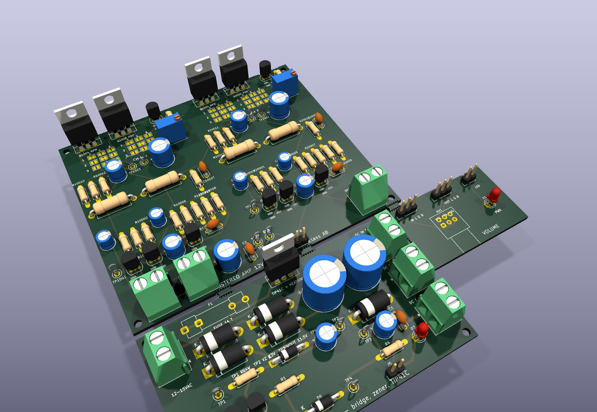
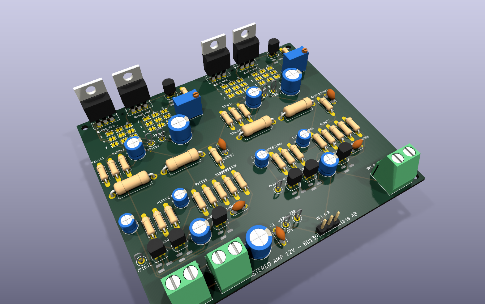
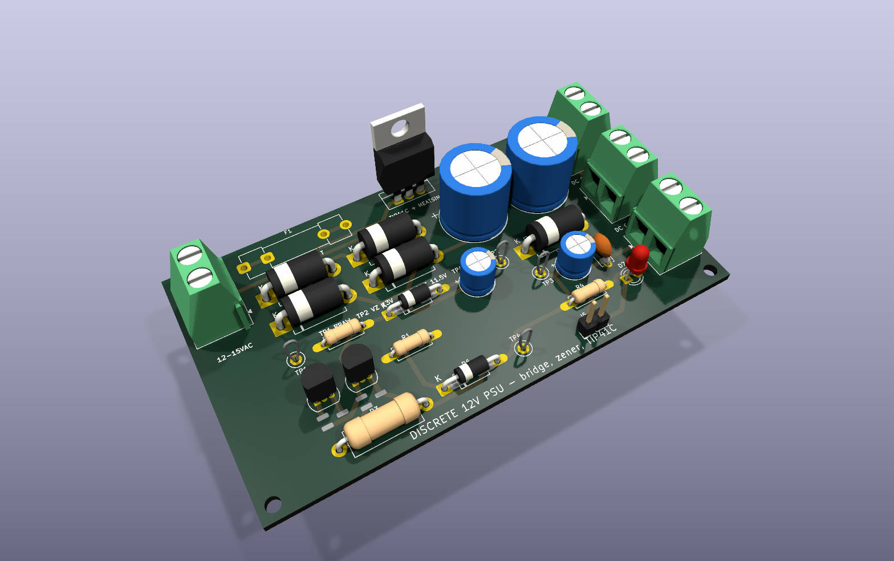
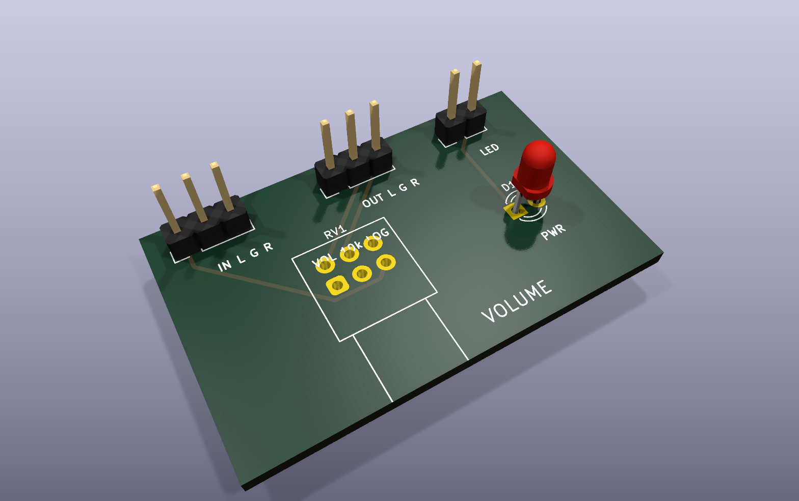

# Stereo class-AB amplifier, discrete 12 V supply and volume board

A hobby / learning project: a two-channel 1 W class-AB amplifier built from BC547/BC557/BD139/BD140,
its own transformer-fed discrete supply, and a volume board, all on one fab panel. It grew out of a review of
a one-transistor "speaker in the collector" amp, which could not be fixed by changing values. Every number
here comes from ngspice; **no board has been built or measured yet** (release 1 is a prototype design).

| Amp | PSU | Volume |
|---|---|---|
|  |  |  |

More views in [docs/images/](docs/images/): top-down 3D renders, 2-layer and single-sided layouts, schematics.

## What it does

| | |
|---|---|
| Output | 0.95 W into 8 ohm at 0.5% THD, 1.3 W into 4 ohm at the onset of clipping, 0.8 W into 10 ohm (per channel, 12 V) |
| Gain / input | 23 (27 dB), 43k input impedance, for a 10k log pot |
| Idle current | output stage 21 mA per channel after setting the trimmer (7 to 10 mV across a 0.47 ohm emitter resistor); about 32 mA per channel from the supply |
| Bandwidth | 20 Hz (8 ohm) / 34 Hz (4 ohm) to 250 kHz |
| Supply | 12 to 15 VAC transformer (1.5 A for full power) or 12 V DC in; 11.6 V out, 2 A clamp |
| Boards | amp 100 x 83 mm, PSU 90 x 50 mm, volume 42 x 26 mm; 2-layer panel 134 x 137 mm; single-sided variants |
| Parts | 107 through-hole parts with 1206 / SOD / SMA twins on the same pads; 36 solder jumpers for output pinouts |

## Documents

1. [docs/01-theory-of-operation.md](docs/01-theory-of-operation.md): every block explained for a first build, with the voltages to expect.
2. [docs/02-simulation-results.md](docs/02-simulation-results.md): all the ngspice tables, including the rejected candidates.
3. [docs/03-design-review.md](docs/03-design-review.md): what was checked, what was found, what is not verified.
4. [docs/04-build-and-bringup.md](docs/04-build-and-bringup.md): assembly order, first power-up, bias setting, test points, troubleshooting.
5. [ORDER_GUIDE.md](ORDER_GUIDE.md): ordering the panel, substitutes, matching, tolerances.
6. [docs/KNOWN_ISSUES.md](docs/KNOWN_ISSUES.md) and [docs/CHANGELOG.md](docs/CHANGELOG.md).
7. [docs/stereo-amp-notes.html](docs/stereo-amp-notes.html): single-file bench-notes page with the verified figures, every sweep table and links to interactive CircuitJS versions of the channel and the supply (download and open locally, or view it through htmlpreview.github.io).

## Files

| Dir | What |
|---|---|
| `sim/` | ngspice decks and results (`sim/README.md`) |
| `kicad/gen_amp.py gen_psu.py gen_vol.py` | schematic generators (kisch.py writer, common.py helpers); `netcheck.py` proves each netlist matches its deck |
| `kicad/gen_pcb_*.py`, `pcbgen.py` | placement + board builder (hybrid footprints, 2-layer or `--single`) |
| `kicad/build.sh <board> [--single]` | place, freerouting, ground pour, DRC, PNG |
| `kicad/panel/` | KiKit multi-design panel, BOMs (bom_all, bom_shopping, bom_mouser) |
| `kicad/release.sh` | fab package -> `release/stereo-amp-release-<date>.zip` |
| `docs/` | the documents above and `docs/images/` |
| `analysis/` | check-schematic / check-pcb analyzer outputs used by the design review |
| `build_all.sh` | regenerate everything |

Schematic symbol UUIDs are deterministic, so re-running a generator keeps PCB parity. Edit the generators,
not the KiCad files.

## Status

Release 1, 2026-10-21: design complete, simulated, DRC clean (2-layer boards and panel), unbuilt. The
single-sided amp board needs hand finishing (see known issues).

## License

[CC BY-NC-SA 4.0](LICENSE): build it, modify it, share it with credit; no commercial use of this or any
derived design without the author's written permission.
