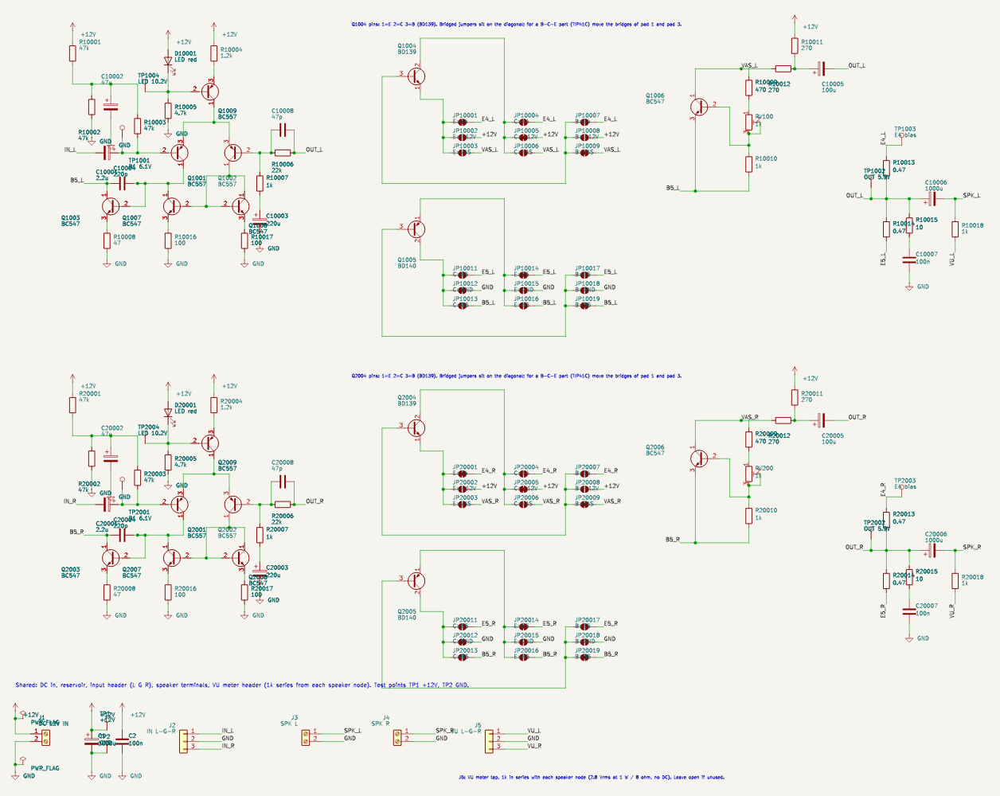
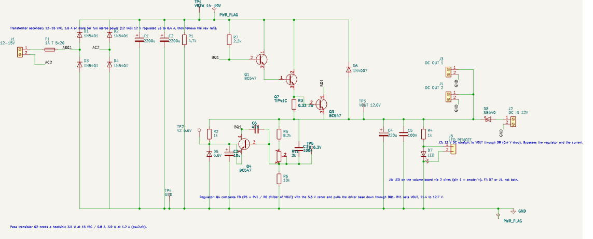
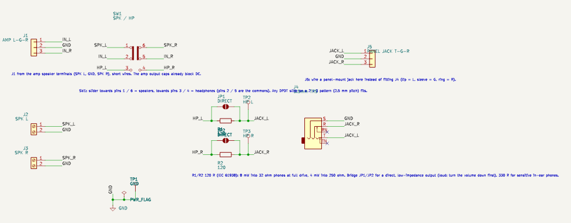

# 1. Theory of operation (release 2)

Written for someone building their first discrete amplifier. Every block is explained by what it does, what
voltage you should see on it, and what breaks if you change it. Simulated numbers are from `sim/` (see
[02-simulation-results.md](02-simulation-results.md)); nothing here has been measured on a built board yet.

## 1.1 The amplifier channel (one of two identical channels)

**What it has to do.** Take a line-level signal from the volume pot (tens of millivolts to about 300 mV peak),
multiply it by about 23, and drive a 4 to 10 ohm speaker from a single 12 V supply without letting any DC flow
through the speaker, and do it with less than 0.1 percent distortion at the levels a desk amp actually runs at.

**What changed from release 1.** The output stage, bias spreader and feedback network are the same. The front end
is new: the differential pair is now PNP with a current-mirror load and a current-source tail, and the voltage
amplifier is an NPN. Release 1 loaded its pair with a plain 4.7k resistor, which throws away half of the pair's
signal current and makes the open-loop gain depend on the collector resistor; the mirror uses both halves, so
the loop has about ten times more gain to correct errors with. Simulated distortion fell from 0.03 to 0.004
percent at 26 mW into 8 ohm, and from 0.18 to 0.013 percent at 52 mW into 4 ohm. It costs three transistors, a
LED and four resistors per channel.

**Input and bias (Cin, Rb1, Rb2, Cbias, R3).** Rb1 and Rb2 (47k / 47k) divide the 12 V rail to 6.0 V, Cbias
(47 uF) removes any supply ripple from that voltage, and R3 (47k) feeds it to the base of Q1. Cin (2.2 uF)
couples the signal in and blocks DC from the pot. Because the feedback (below) forces the output to the same
voltage as Q1's base (minus a few tens of millivolts of base current drop), this divider is what puts the output
at half the supply, 6.1 V, where it can swing equally up and down. The input impedance is 46k, so a 10k pot in
front of it behaves like a pot (gain changes only 10 percent across its travel).

**Differential pair with current-mirror load (Q1, Q2, Q7, Q8, Re7, Re8).** Two BC557 PNPs share one tail.
The signal goes into Q1's base; a copy of the output, scaled down by Rf/Rg, comes back into Q2's base. The pair
steers the tail current between its two collectors according to the difference between the two bases. Q8 is
wired as a diode and copies Q2's collector current into Q7 (the "mirror"); at Q1's collector the mirror's copy of
Q2's current meets Q1's own current, and the difference, which is the whole error signal, goes into the base of
the voltage amplifier. The 100 ohm emitter resistors make the two mirror transistors match without selection.
Negative feedback keeps adjusting the output until the fed-back copy equals the input, which is why the gain is
set by two resistors (1 + 22k/1k = 23) and not by the transistors.

**Tail current source (Q9, Rt, Dled, Rled).** A BC557 with 1.2k in its emitter feeds the pair 1 mA. Its base
sits on a red LED (1.8 V below the rail, fed by Rled 4.7k), so the tail current is (1.8 - 0.65) / 1.2k and does
not move with supply ripple or with the signal. The LED must be RED: a green or blue one has a higher forward
voltage and doubles the tail current. It glows faintly, which also tells you the channel is powered. Two 1N4148
in series work instead with Rt changed to 680 ohm. Test point TPx4 sits on the LED: expect 10.1 V.

**Voltage amplifier (Q3, Re3, Cm).** Q3 is a BC547 whose base hangs on the mirror output and whose collector
runs at about 10 mA through the bootstrapped load. The 47 ohm emitter resistor makes its gain predictable; Cm
(220 pF) between its collector and base is the main compensation capacitor and rolls the loop gain off so the
feedback cannot oscillate. The second compensation part is Cf (47 pF) across the 22k feedback resistor, which
lets high frequencies feed back a little earlier. Together they give a 1 kHz square wave 5.7 percent overshoot
with 100 nF across the speaker and 14 percent with 470 nF, and a -3 dB bandwidth of 120 kHz. Without Cf the
overshoot is 34 percent and the response peaks 1.3 dB at 1 MHz: Cf is not optional. Keep both C0G.

**Bootstrap (R5a, R5b, Cboot).** Q3 needs a load to develop voltage across. Two 270 ohm resistors from +12 V
would waste the swing, so Cboot (100 uF) "lifts" their midpoint with the output signal: the lower resistor then
sees an almost constant voltage, behaves like a current source, and the output can swing to within 1 V of the
rails. The 10 mA standing current covers the NPN output's base current at full drive into 4 ohm.

**Bias spreader (Q6, Rm1, RV, Rm2).** The two output transistors need about 1.3 V between their bases so both
conduct a little at idle (class AB, no crossover notch). Q6 with its two resistors is a "Vbe multiplier": it
produces (1 + (Rm1 + RV)/Rm2) times its own base-emitter voltage, and because Q6 sits next to the output
transistors its voltage drops as they warm up, which keeps the idle current from running away. The trimmer sets
the idle current: 7 to 10 mV across one 0.47 ohm emitter resistor = 15 to 20 mA. The simulation shows 21 mA at
25 C rising to 30 mA at 70 C with the spreader held cold; in practice Q6 tracks the outputs.

**Output stage (Q4, Q5, Re4, Re5).** A BD139 (NPN) and a BD140 (PNP) emitter follower push and pull the speaker
current. The 0.47 ohm emitter resistors share the current between the two and stabilise the idle current. Each
transistor dissipates about 0.85 W at full drive into 4 ohm: a clip-on heatsink is advisable for 4 ohm speakers,
not needed for 8 ohm.

**Output network (Cout, Rz, Cz, Rvu).** Cout (1000 uF) blocks the 6.1 V DC from the speaker and sets the bass
limit: -3 dB at 34 Hz into 4 ohm, 20 Hz into 8 ohm. Rz + Cz (10 ohm + 100 nF, the Zobel network) keeps the
amplifier loaded at high frequency even when a long speaker cable looks capacitive. Rvu (1k) taps the speaker
node (after the capacitor, so no DC) to the shared VU header J5: 2.8 Vrms at 1 W into 8 ohm, through 1k, so a
600 ohm moving-coil meter sees about 1 Vrms and an electronic meter with a high-impedance input sees the full
speaker voltage. Nothing happens when the header is left open.

**The 3x3 pinout blocks.** Q4 and Q5 sit on TO-220 footprints whose three pads go to a 3 x 3 grid of solder
jumpers: row = device pin 1, 2, 3; column = the net that pin should reach (E, C, B). A BD139 is E-C-B, so the
diagonal is bridged as shipped. A TIP41C is B-C-E: cut the pad-1 and pad-3 bridges and bridge pad 1 to B and
pad 3 to E. A BC337 (C-B-E) uses 1-C, 2-B, 3-E. The blocks exist so you can fit whatever you have. Every
TO-92 position also carries a SOT-23 twin.

**Names in this text vs. references on the board.** The silkscreen uses KiCad references with the channel
number in front (1 = left, 2 = right):

| Name | Left channel | Right channel | Name | Left | Right |
|---|---|---|---|---|---|
| Cin | C10001 | C20001 | Q1, Q2 (PNP pair) | Q1001, Q1002 | Q2001, Q2002 |
| Rb1, Rb2, Cbias, R3 | R10001, R10002, C10002, R10003 | R20001, R20002, C20002, R20003 | Q7, Q8, Re7, Re8 (mirror) | Q1007, Q1008, R10016, R10017 | Q2007, Q2008, R20016, R20017 |
| Q9, Rt, Dled, Rled (tail) | Q1009, R10004, D10001, R10005 | Q2009, R20004, D20001, R20005 | Q3 (VAS), Re3, Cm | Q1003, R10008, C10004 | Q2003, R20008, C20004 |
| Rf, Rg, Cg, Cf | R10006, R10007, C10003, C10008 | R20006, R20007, C20003, C20008 | Q6, Rm1, RV, Rm2 | Q1006, R10009, RV100, R10010 | Q2006, R20009, RV200, R20010 |
| R5a, R5b, Cboot | R10011, R10012, C10005 | R20011, R20012, C20005 | Q4, Q5, Re4, Re5 | Q1004, Q1005, R10013, R10014 | Q2004, Q2005, R20013, R20014 |
| Cout, Rz, Cz, Rvu | C10006, R10015, C10007, R10018 | C20006, R20015, C20007, R20018 | TPx1 base, TPx2 out, TPx3 bias, TPx4 LED | TP1001-TP1004 | TP2001-TP2004 |
| jumper block | JP10001-09 (Q4), JP10011-19 (Q5) | JP20001-09, JP20011-19 | shared | J1 12 V, J2 IN, J3/J4 SPK, J5 VU, C1/C2, TP1/TP2 | |

**Numbers to expect at the test points.** TPx1 (base of Q1) 6.1 to 6.2 V, TPx2 (output) 6.1 V, TPx4 (LED)
10.1 V, TPx3 minus TPx2 = 7 to 10 mV after setting the trimmer. Idle supply current is about 34 mA per channel
(21 mA output stage, 10 mA VAS, 1 mA tail, 2 mA LED), so about 70 mA for both channels together.

## 1.2 The power supply (closed loop)

**Input.** A transformer with a 12 to 15 VAC secondary (or 12 V DC, see below) comes in on a screw terminal
through a 1 A slow fuse. Mains never touches the board.

**Rectifier and reservoir (D1 to D4, C1, C2, R1).** Four 1N5401s make a bridge; two 2200 uF capacitors smooth
the result to a raw rail of 14 to 19 V with up to a volt of ripple at 1 A. R1 (4.7k) bleeds the capacitors down
after switch-off.

**Pass pair and drive (Q1, Q2, R7).** A BC547 driving a TIP41C (a Darlington pair) passes the load current. R7
(2.2k) from the raw rail pulls the driver's base up, so with nothing else connected the pair would turn fully on
and the output would follow the raw rail. Something has to pull that base down to exactly the right point.

**Reference (R2, D5, C3).** R2 (1k) feeds 6 mA into a 5.6 V zener, and C3 (10 uF) filters its noise. The zener
is fed from the regulated output, not the raw rail, so once the loop is closed the reference sees no ripple at
all. 5.6 V is the zener voltage with the smallest temperature drift, and the drift it has (+2 mV/C) cancels the
-2 mV/C of Q4's base-emitter junction, which sits in series with it. At power-up the output is zero, the zener is
unfed, Q4 is off, R7 turns the pass pair fully on, and the output rises until the loop takes over.

**Error amplifier and divider (Q4, R5, RV1, R6, C6, C7).** R5 (8.2k) plus the 2k trimmer over R6 (10k) divides
the output down to the "feedback" voltage FB. Q4's emitter sits on the 5.6 V zener, so Q4 starts to conduct when
FB reaches 5.6 + 0.65 = 6.3 V; its collector then pulls the driver base down through R7 and the output stops
rising. If the output sags under load, FB drops, Q4 conducts less, the base rises, the pass pair opens further:
the output is held at 6.3 V x (R5 + RV1 + R6) / R6 = 12.0 V. C6 (47 nF) from Q4's collector to base slows the
loop just enough that it cannot ring; C7 (100 nF) from the output straight to FB lets a sudden load step reach
Q4 before the divider does. Simulated: 12.10 V at 0.1 A to 11.96 V at 1.2 A from 15 VAC, 4 to 70 mV ripple, a
1 A load step dips 0.14 V and settles without ringing. Release 1's open-loop follower dropped 0.4 V over the
same range and passed ten times the ripple. RV1 sets the output between 11.4 and 12.7 V; set 12.0 V.

**Current clamp (Q3, R3).** The load current flows through R3 (0.33 ohm). When the voltage across it reaches
0.65 V (about 2 A), Q3 turns on and steals the driver's base drive, so a short circuit draws 2.1 A instead of
burning the transformer. Q3 and Q4 both pull on the same node (BQ1); whichever asks for less current wins.

**Protection and DC-in (D6, D8).** D8 (SB540 Schottky) lets 12 V DC from the "DC IN" terminal feed the output
directly, bypassing the regulator and the clamp. D6 (1N4007) from the output back to the raw rail stops that
12 V from appearing as a reverse voltage across the pass transistors' base-emitter junctions; with DC in and no
transformer the raw rail floats up to 11.2 V through D6 and the pass transistor sees 0.37 V. With both sources
connected the regulator at 12.0 V supplies the load and the diode path idles.

**Heat.** Q2 dissipates (raw rail minus 12 V) times the load current: 3.9 W from a 15 VAC transformer at 1.2 A,
so it needs a heatsink (10 C/W or better). R7 dissipates 15 mW normally and 0.1 W with the output shorted.

**LED.** R4 (1k) and the LED show the output is up. The LED can sit on the PSU (D7) or on the front panel via
the 2-pin header J5 to the volume board.

**Transformer sizing.** From 12 VAC the supply holds 12 V up to about 0.4 A (11.8 V, 160 mV ripple), which is
normal listening. Above that the raw rail is lower than the output wants and the supply follows the raw rail
down (10.1 V at 1 A); the amp still works, with less headroom. Set the trimmer to 11.5 V with a 12 VAC
transformer so the loop keeps a little headroom. For full stereo power into 4 ohm (0.6 to 0.7 A) use 15 VAC at
1.5 A or more.

**Test points.** TP1 VRAW 14 to 19 V, TP2 VZ 5.6 V, TP3 VOUT 12.0 V, TP5 FB 6.3 V, TP4 GND.

## 1.3 The volume board

A dual 10k logarithmic pot between two 3-pin headers (L, GND, R in; L, GND, R out). Pin 3 of each gang (the
clockwise end) takes the input, pin 1 is ground, pin 2 (the wiper) feeds the amp. Log taper makes the knob feel
linear to the ear. The board also carries the optional front-panel LED (D1), fed by two wires from the PSU.

## 1.4 The headphone board

The board sits between the amp's speaker terminals and the speakers: a 3-pin header "FROM AMP" (L, G, R),
two screw terminals to the speakers, and a 3.5 mm jack.

**Why a switch and not the jack's own contacts.** A 3.5 mm jack with switch pins has one normally-closed contact
per channel that opens when a plug goes in. With one contact you can do one of two things: put the speaker on
the contact so it is cut off when you plug in, or put a series resistor between the amp and the jack so the
headphones are not fed the full 3.4 V peak the amp can swing. You cannot do both: if the resistor is between the
amp and the tip and the speaker hangs on the contact, the speaker is fed through the resistor; if the speaker
hangs on the amp side, it is never cut off. 3.4 V peak into 32 ohm headphones is 180 mW, which is painful and
over the rating of many phones, so the resistor is not optional. The board therefore uses a DPDT slide switch
(SW1): slider towards pins 1 / 6 sends both channels to the speaker terminals, towards pins 3 / 4 through the
resistors to the jack. The jack's switch pins TN / RN are left open, so a plain 3-pin jack fits too, and header
J5 duplicates the jack's T, S and R pins for a panel-mount jack.

**Series resistors (R1, R2, JP1, JP2).** 120 ohm is the IEC 61938 headphone source impedance: 8 mW into 32 ohm
and 4 mW into 250 ohm at full drive, loud enough for any headphone and safe for all of them. JP1 / JP2 (open
solder jumpers, "DIRECT") bypass the resistors for people who want the amp's low output impedance on
low-impedance phones; bridge them only after turning the volume down. 330 ohm suits sensitive in-ear phones.

**Test points.** TP1 GND, TP2 / TP3 the left / right signal after the resistors (speaker level when the switch
is on headphones and nothing is plugged in).
