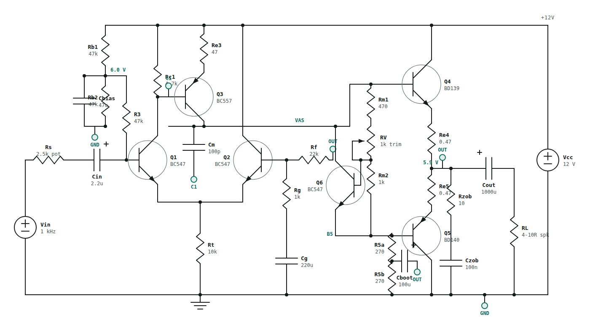
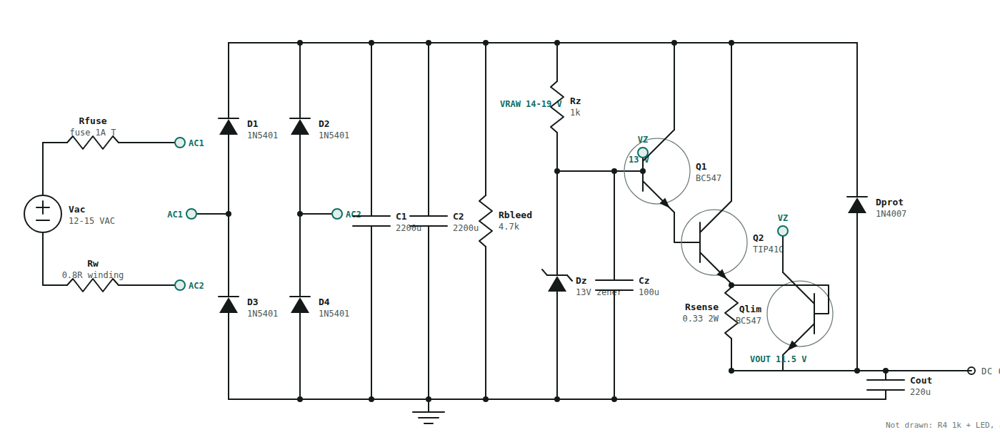

# 1. Theory of operation

Written for someone building their first discrete amplifier. Every block is explained by what it does, what
voltage you should see on it, and what breaks if you change it. Simulated numbers are from `sim/` (see
[02-simulation-results.md](02-simulation-results.md)); nothing here has been measured on a built board yet.

## 1.1 The amplifier channel (one of two identical channels)

**What it has to do.** Take a line-level signal from the volume pot (tens of millivolts to about 300 mV peak),
multiply it by about 20, and drive a 4 to 10 ohm speaker from a single 12 V supply without letting any DC flow
through the speaker.

**Input and bias (C1, R1, R2, Cb, R3).** R1 and R2 (47k / 47k) divide the 12 V rail to 6.0 V, Cb (47 uF) removes
any supply ripple from that voltage, and R3 (47k) feeds it to the base of Q1. C1 (2.2 uF) couples the signal in
and blocks DC from the pot. Because the feedback (below) forces the output to the same voltage as Q1's base,
this divider is what puts the output at half the supply, 5.9 V, where the output can swing equally up and down.
The input impedance is 43k, so a 10k pot in front of it behaves like a pot (gain changes only 10 percent
across its travel).

**Differential pair (Q1, Q2, Rt).** Two BC547s share one 10k tail resistor (0.5 mA). The signal goes into Q1's
base; a copy of the output, scaled down by Rf/Rg, comes back into Q2's base. The pair amplifies the difference
between the two: the circuit keeps adjusting the output until the fed-back copy equals the input. That is what
negative feedback means here, and it is why the gain is set by two resistors (1 + 22k/1k = 23) and not by the
transistors.

**Voltage amplifier (Q3, Rc1, Re3, Cm).** Q1's collector current flows through Rc1 (4.7k); the voltage across it
drives Q3, a BC557 PNP whose collector runs at about 10 mA and drives the output stage. Cm (100 pF) between Q3's
collector and base is the compensation capacitor: it rolls the gain off above about 250 kHz so the feedback
loop cannot oscillate. A 1 kHz square wave overshoots 5.5 percent into 8 ohm and 6.9 percent with 470 nF across
the speaker; do not change Cm by more than 68 to 150 pF.

**Bootstrap (R5a, R5b, Cboot).** Q3 needs a load to develop voltage across. Two 270 ohm resistors in series
would waste the swing, so Cboot (100 uF) "lifts" their midpoint with the output signal: the top resistor then
sees an almost constant voltage, behaves like a current source, and the output can swing to within 1 V of the
rails. The standing current through these resistors must cover the PNP output's base current: with 2 x 680 ohm
(4 mA) the channel made only 0.3 W into 4 ohm; 2 x 270 ohm (10 mA) gives 1.3 W.

**Bias spreader (Q6, Rm1, RV, Rm2).** The two output transistors need about 1.3 V between their bases so both
conduct a little at idle (class AB, no crossover notch). Q6 with its two resistors is a "Vbe multiplier": it
produces (1 + (Rm1 + RV)/Rm2) times its own base-emitter voltage, 1.30 V at the shipped setting, and because
Q6 sits next to the output transistors its voltage drops as they warm up, which keeps the idle current from
running away. The trimmer sets the idle current: 7 to 10 mV across one 0.47 ohm emitter resistor = 15 to 20 mA.
Two plain diodes instead of Q6 gave 50 mA (too hot), one diode plus a resistor gave crossover distortion of 1 to
5 percent; the simulation runs that showed this are in the results file.

**Output stage (Q4, Q5, Re4, Re5).** A BD139 (NPN) and a BD140 (PNP) emitter follower push and pull the speaker
current. The 0.47 ohm emitter resistors share the current between the two and stabilise the idle current. Each
transistor dissipates about 0.85 W at full drive into 4 ohm: a clip-on heatsink is advisable for 4 ohm speakers,
not needed for 8 ohm.

**Output network (Cout, Rz, Cz).** Cout (1000 uF) blocks the 5.9 V DC from the speaker and sets the bass limit:
-3 dB at 34 Hz into 4 ohm, 20 Hz into 8 ohm. Rz + Cz (10 ohm + 100 nF, the Zobel network) keeps the amplifier
loaded at high frequency even when a long speaker cable looks capacitive.

**The 3x3 pinout blocks.** Q4 and Q5 sit on TO-220 footprints whose three pads go to a 3 x 3 grid of solder
jumpers: row = device pin 1, 2, 3; column = the net that pin should reach (E, C, B). A BD139 is E-C-B, so the
diagonal is bridged as shipped. A TIP41C is B-C-E: cut the pad-1 and pad-3 bridges and bridge pad 1 to B and
pad 3 to E. A BC337 (C-B-E) uses 1-C, 2-B, 3-E. The blocks exist so you can fit whatever you have.

**Names in the figure vs. references on the board.** The figure uses short names; the silkscreen uses KiCad
references with the channel number in front (1 = left, 2 = right):

| Figure | Left channel | Right channel | Figure | Left | Right |
|---|---|---|---|---|---|
| Cin | C10001 | C20001 | Q1, Q2 | Q1001, Q1002 | Q2001, Q2002 |
| Rb1, Rb2, Cbias, R3 | R10001, R10002, C10002, R10003 | R20001, R20002, C20002, R20003 | Q3 (VAS), Rc1, Re3, Cm | Q1003, R10004, R10008, C10004 | Q2003, R20004, R20008, C20004 |
| Rt | R10005 | R20005 | Rf, Rg, Cg | R10006, R10007, C10003 | R20006, R20007, C20003 |
| Q6, Rm1, RV, Rm2 | Q1006, R10009, RV100, R10010 | Q2006, R20009, RV200, R20010 | R5a, R5b, Cboot | R10011, R10012, C10005 | R20011, R20012, C20005 |
| Q4, Q5, Re4, Re5 | Q1004, Q1005, R10013, R10014 | Q2004, Q2005, R20013, R20014 | Cout, Rz, Cz | C10006, R10015, C10007 | C20006, R20015, C20007 |
| TPx1 base, TPx2 out, TPx3 bias | TP1001, TP1002, TP1003 | TP2001, TP2002, TP2003 | jumper block | JP10001-09 (Q4), JP10011-19 (Q5) | JP20001-09, JP20011-19 |

**Numbers to expect at the test points.** TPx1 (base of Q1) 5.9 V, TPx2 (output) 5.9 V, TPx3 minus TPx2 =
7 to 10 mV after setting the trimmer. Idle supply current is about 32 mA per channel (21 mA output stage, 10 mA VAS, 1 mA front end), so about 65 mA for both channels together.

## 1.2 The power supply

**Input.** A transformer with a 12 to 15 VAC secondary (or 12 V DC, see below) comes in on a screw terminal
through a 1 A slow fuse. Mains never touches the board.

**Rectifier and reservoir (D1 to D4, C1, C2, R1).** Four 1N5401s make a bridge; two 2200 uF capacitors smooth
the result to a raw rail of 14 to 19 V with a few hundred millivolts of ripple at 1 A. R1 (4.7k) bleeds the
capacitors down after switch-off.

**Reference (R2, D5, C3).** R2 (1k) feeds about 6 mA into a 13 V zener; C3 (100 uF) filters the zener's noise
and the remaining ripple. This 13 V is the "target" for the output.

**Pass transistors (Q1, Q2).** A BC547 driving a TIP41C (a Darlington pair) follows the 13 V reference, minus
two base-emitter drops, so the output sits at about 11.6 V. The output is only as steady as the reference, and
load regulation is 11.6 V at 0.1 A to 11.2 V at 1.1 A. Q2 dissipates (raw rail minus 11.6 V) times the load
current: up to 4.9 W from a 15 VAC transformer at 1.1 A, so it needs a heatsink.

**Current clamp (Q3, R3).** The load current flows through R3 (0.33 ohm). When the voltage across it reaches
0.65 V (about 2 A), Q3 turns on and steals the base drive from Q1, so a short circuit draws 2.1 A instead of
burning the transformer. The first version put Q3 on Q2's base and did not work: the BC547 driver could supply
more current than Q3 could steal (the simulation showed 3 A). Q3 must sit on the driver's base.

**Protection and DC-in (D6, D8).** D8 (SB540 Schottky) lets 12 V DC from the "DC IN" terminal feed the output
directly, bypassing the regulator and the clamp. D6 (1N4007) from the output back to the raw rail stops that
12 V from appearing as a reverse voltage across the pass transistors' base-emitter junctions (it would break
them above 5 V); with DC in and no transformer the raw rail simply floats up to 11.25 V through D6 and the pass
transistor sees 0.65 V.

**LED.** R4 (1k) and the LED show the output is up. The LED can sit on the PSU (D7) or on the front panel via
the 2-pin header J5 to the volume board.

**Transformer sizing.** From 12 VAC the supply regulates up to 0.38 A, which is normal listening. Above that
it follows the raw rail down (10.2 V at 1 A) and the amp still works, just with less headroom. For full stereo
power into 4 ohm (0.6 to 0.7 A) use 15 VAC at 1.5 A or more.

## 1.3 The volume board

A dual 10k logarithmic pot between two 3-pin headers (L, GND, R in; L, GND, R out). Pin 3 of each gang (the
clockwise end) takes the input, pin 1 is ground, pin 2 (the wiper) feeds the amp. Log taper makes the knob feel
linear to the ear. The board also carries the optional front-panel LED (D1), fed by two wires from the PSU.
